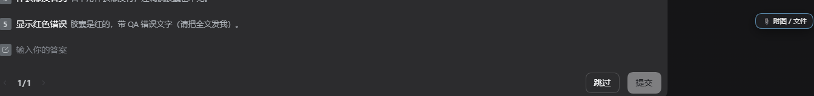

# dsh-plugin-question-attachments

[中文](README.zh.md) | English

Attach images and files **while answering an `ask_user_question` card** in [DeepSeek Harness](https://github.com/deepseek-ai/deepseek-harness).



> Status: **alpha / minimal viable build**. Tested against DSH `0.2.2-rc.1` (Desktop, Windows).

## The problem

`ask_user_question` takes over the composer position with an answer card, and the answer payload is text only:

```ts
{ selected: string[], custom?: string }
```

Attachments in DSH are *prompt credentials* — they are stored by `ctx.fileUpload` and consumed when a **user message** is admitted. A tool answer has no channel for them, so while the card is up there is no way to drop a screenshot into the answer.

## What this plugin does

While the current Session has a pending interaction (the question card owns the composer):

1. a small chip appears in the bottom-right corner — **📎 attach image / file**;
2. click it, paste (`Ctrl+V`), or drop a file onto it;
3. the file is uploaded with `ctx.fileUpload.uploadImage()` / `upload()`, producing a receipt;
4. the receipt is sent to the agent as a **steering prompt**:
   `session.prompt([{ type: 'file', receiptId }, { type: 'text', text }], 'steer')`.

During a blocking question the Session is still `running`, so the steer is accepted by the Inbox and queued. The host admits queued steers only after the current tool wait ends — i.e. **the model sees the answer and the attachment at the same step boundary**.

No protocol change, no patched installation, fully removable.

## Install

The plugin is a normal DSH bundle package with a web client half.

```powershell
# 1. get the package somewhere local
git clone https://github.com/rxdage/dsh-plugin-question-attachments "$env:LOCALAPPDATA\dsh-plugin-question-attachments"

# 2. link it into your desktop profile
$profile = "$env:USERPROFILE\.dsh\profiles\desktop"
New-Item -ItemType Junction -Path "$profile\node_modules\dsh-plugin-question-attachments" `
  -Target "$env:LOCALAPPDATA\dsh-plugin-question-attachments"
```

Then add it to `profiles/desktop/package.json`:

```jsonc
{
  "dependencies": {
    "dsh-plugin-question-attachments": "link:C:/Users/<you>/AppData/Local/dsh-plugin-question-attachments"
  },
  "dsh": { "profile": { "bundles": [ /* ..., */ "dsh-plugin-question-attachments" ] } }
}
```

and restart DeepSeek Harness. The bundle's `cordis.patch.yml` inserts the loader row; the package's `dsh.client` declaration serves `lib/client.js` to the browser.

To uninstall: remove the junction and those two entries, then restart.

## Usage

Ask the agent something that triggers an `ask_user_question`, and while the card is shown:

- click **📎 attach image / file**, or
- paste a screenshot from the clipboard, or
- drag a file onto the chip.

The chip reports upload progress and failures in place. The attachment arrives as a queued user message; answer the question and the agent receives both in its next step.

## Limits

- Only visible while a question/approval card is pending. Once the card is hidden, `pendingInteraction` clears and the chip disappears.
- Steering during a blocked tool call is queued, not delivered immediately — by design.
- One message per file; no drag-and-drop reordering or previews yet.
- The desktop profile is the only profile wired up in the example; any profile with the `fileUpload` + `sessions` client services works.

## Compatibility

Built and verified against DSH `0.2.2-rc.1`. It only uses documented client services (`slots`, `sessions`, `uiSession`, `fileUpload`, `session.prompt`) and no private APIs, so it should survive minor releases — but the client bundle format is pre-1.0, so check the [CHANGELOG](CHANGELOG.md) after upgrades.

## License

MIT
